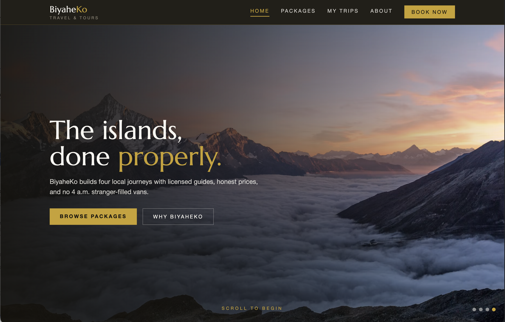

<br />
<div align="center">
  <a href="https://github.com/your-username/biyaheko">
    
  </a>

  <h3 align="center">BiyaheKo Travel &amp; Tours</h3>

  <p align="center">
    Discover the Philippines in style. A Blazor travel agency model: browse local tour packages, read the story-first detail pages, and reserve trips with validated booking inquiries.
  </p>

  <p align="center">
    <strong>Epilan, Gian Cedrick G.</strong><br />
    BSCS 3 - F1
  </p>
</div>

## Built With

* [![Blazor][Blazor-shield]][Blazor-url]
* [![.NET][Dotnet-shield]][Dotnet-url]
* [![Tailwind CSS][Tailwind-shield]][Tailwind-url]
* [![C#][Csharp-shield]][Csharp-url]

## Getting Started

### Prerequisites

* [.NET 10 SDK](https://dotnet.microsoft.com/download/dotnet/10.0)

### Run it

```sh
dotnet restore
dotnet build
dotnet run
```

Then open the URL shown in the terminal (typically `http://localhost:5000`).

<!-- MARKDOWN LINKS & IMAGES -->

[Blazor-shield]: https://img.shields.io/badge/Blazor-512BD4?style=for-the-badge&logo=blazor&logoColor=white
[Blazor-url]: https://dotnet.microsoft.com/apps/aspnet/web-apps/blazor
[Dotnet-shield]: https://img.shields.io/badge/.NET_10-512BD4?style=for-the-badge&logo=dotnet&logoColor=white
[Dotnet-url]: https://dotnet.microsoft.com/
[Tailwind-shield]: https://img.shields.io/badge/Tailwind_CSS-38BDF8?style=for-the-badge&logo=tailwind-css&logoColor=white
[Tailwind-url]: https://tailwindcss.com/
[Csharp-shield]: https://img.shields.io/badge/C%23-239120?style=for-the-badge&logo=c-sharp&logoColor=white
[Csharp-url]: https://learn.microsoft.com/dotnet/csharp/
